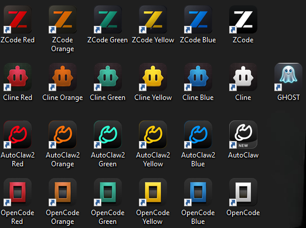

# GHOST — Guided Hardware & OS Scrubbing Toolkit

[](https://github.com/fotedev/ghost/actions/workflows/ci.yml)
[](LICENSE)
[](#prerequisites)
[](#prerequisites)

Fresh-start toolkit for local AI-IDE identity stores: rotate device identifiers
for **Cursor**, **Windsurf / Devin Desktop**, **Trae**, **Qoder**, **ZCode**,
**QoderWork**, **MiniMax Agent**, and **OpenCode**, and inspect or reset system
machine IDs. Built for privacy hygiene, multi-account testing, and
CI/dev-environment resets.

<p align="center">
  
  <br/>
  <em>All four clone suites — ZCode, Cline, AutoClaw2, OpenCode — each with its Primary (stock icon) plus five color-branded clones, and the GHOST launcher icon.</em>
</p>

## Disclaimer

These scripts modify application and system identifiers on machines **you own
or are authorized to administer**. They may violate vendor Terms of Service.
Use at your own risk — no outcome is guaranteed. See [SECURITY.md](SECURITY.md).

## How it works

Applications create unique IDs to identify your computer. Each reset script
generates fresh IDs, updates the relevant config files (JSON, SQLite, binary
stores), **verifies every write by re-reading it**, backs up everything it
touches, and emits an audit log plus a self-contained restore script.

| Task | Windows | Linux | macOS |
|------|---------|-------|-------|
| Reset Cursor | `reset_cursor.ps1` | `reset_cursor.sh` | `reset_cursor.sh` (v0.1: 13 steps - Electron stores, delete-secrets purge, salt, os_crypt pointer, network/tracking sweeps, sentry, caches, Crashpad/logs, workspaceStorage upserts; Local Storage/Backups/cursorDiskKV PRESERVED; ALL paths DERIVED - live verification pending) |
| Reset Windsurf\Devin | `reset_devin.ps1` | `reset_devin.sh` | `reset_devin.sh` (v0.1: 17 steps - Electron stores, the Windows v0.4 ESCAPE'd windsurf/devin secret DELETE, salt + os_crypt pointer + username scrub, network sweeps, the EXTENDED rebrand-era cache sweep, credentials.toml + org_id blanking, codeium device_id, argv.json crash-reporter-id in both homes, installation_ids, updater trees; Local Storage/Backups/WebStorage/IndexedDB PRESERVED, workspaceStorage upsert-only; ALL paths DERIVED - live verification pending) |
| Reset Trae | `reset_trae.ps1` | `reset_trae.sh` (v0.3: aha flag + iCubeAuthInfo removal + ckg_server local_env rotation; derived paths) | `reset_trae.sh` (v0.1: 15 steps - Electron stores, iCubeAuthInfo removal, aha flag in both stores, aha tree, ckg 19-digit device_id + host_map, env_codekg.db, ai-agent identity-rows-only scrub, salt, os_crypt pointer, sweeps; Local Storage/Backups/workspaceStorage/ai-agent chats PRESERVED; ALL paths DERIVED - live verification pending) |
| Reset Qoder | `reset_qoder.ps1` | `reset_qoder.sh` (v0.2: installation_id/.auth rotations; derived paths) | `reset_qoder.sh` (v0.1: full-attempt 9 steps - Electron stores, secret purge, salt, machineid files, ~/.qoder rotations, Library sweep, webview partitions; ALL paths DERIVED - live verification pending) |
| Reset QoderWork | `reset_qoderwork.ps1` | `reset_qoderwork.sh` (v0.2: agents.db purge-tables; derived paths) | `reset_qoderwork.sh` (v0.1: 16 steps - Electron stores, machineId files in 3 spellings, installation_id, .status.json logged-out patch, registry commands=[], cache/log sweeps, rum store, Local State delete, partition salt/network/storage, cache trees, the agents.db purge-tables whitelist (chats + proxy preserved), auth.dat deletes; ALL paths DERIVED - live verification pending) |
| Reset ZCode (+Qoder stores) | `reset_zcode.ps1` (`-Target Primary\|Secondary\|Third\|Fourth\|Fifth\|Sixth\|Both\|All`) | `reset_zcode.sh` (v0.2: CLI v2 telemetry-state/credentials/setting scrubs; `--instance` = clone reset; shared CLI db untouched - matches Windows) | `reset_zcode.sh` (v0.1: the Linux v0.2 map verbatim, 6 steps - Electron stores, telemetry-state deviceMid, credentials OAuth clear, setting.json deviceSid, ~/Library sweep (DERIVED globs), final probe; shared CLI db + cli/config.json PRESERVED; ALL paths DERIVED - live verification pending) |
| Reset MiniMax/OpenCode | `reset_minimax_opencode.ps1` | `reset_minimax_opencode.sh` (v0.2: mcode-public auth deletions + session-handoff device-id; derived paths; CLI XDG auth untouched) | `reset_minimax_opencode.sh` (v0.1: 13 steps, MiniMax-only - Electron stores, machineId files in 3 spellings, mcode-public auth deletions, session-handoff device-id, local-runtime wipe, agent-config user/sharedUser removal, remote-control desktop_device_id, updaterId, Chromium sweeps, mavis-browser Local Storage, misc run-state; sessions/sqlite.db/credentials + OpenCode CLI XDG auth PRESERVED; ALL paths DERIVED - live verification pending) |
| ZCode clones (Primary + 5 branded clones) | `launch_zcode_second_instance.ps1 -Instance Second\|Third\|Fourth\|Fifth\|Sixth` + `Launch-ZCode-*.bat` | `launch_zcode_clone.sh --instance Second\|...\|Sixth` (PR 8, derived - live acceptance pending) | — |
| ZCode clone MCP sync (definitions-only) | `sync_zcode_assets.ps1 -McpOnly -Target Second\|...\|All` | `sync_zcode_assets.sh --instance Second\|...\|All\|--dry-run` (v0.1 MCP-only: core json-merge-defs verb; skills/plugins areas need LC-1 evidence) | — |
| ZCode clone memories (one shared store) | `sync_zcode_memories.ps1 -Target Second\|...\|All` (`-AllowRunning` for live instances, `-DryRun`) | — (twin pending) | — |
| ZCode Primary (stock profile, never elevated) | `launch_zcode_primary.ps1` (explorer spawn, verify-after) | — | — |
| ZCode light headless worker (no desktop window) | `launch_zcode_cli_light.ps1 -Instance Second\|...\|Sixth` (`-Prompt` / `-Server`) | `launch_zcode_cli_light.sh --instance Second\|...\|Sixth` (`-p` one-shot; PR 8, derived) | — |
| OpenCode light headless worker (CLI only, clone XDG state) | `launch_opencode_cli_light.ps1 -Instance c1\|...\|c5` (`-Prompt` / `-Server` / `-Login` / `-StopService`) | — | — |
| Cline light headless worker (cline-cli.exe on the clone's CLINE_DIR state) | `launch_cline_cli_light.ps1 -Instance c1\|...\|c5` (`-Prompt` one-shot / `-Json` / `-Auth`) | — | — |
| Claude Code light worker (terminal TUI/CLI, per-instance `CLAUDE_CONFIG_DIR` home) | `launch_claude_code_light.ps1 -Instance c1\|...\|c5` (`-Prompt` one-shot / `-Yolo` / `-Login` / `-Status`) — Terminal Agents [1]/[2] | — | — |
| Z.ai gateway lever (claude-code rides the existing GLM plan — no Anthropic account; ANTHROPIC_BASE_URL/AUTH_TOKEN via setx) | `launch_claude_code_light.ps1 -Gateway` — Terminal Agents [5] (recipe when unset, real verify turn when set) | — | — |
| Claude Code identity reset (fresh machineID on next run; transcripts + settings + mcpServers kept) | `reset_claude_code.ps1` (`-Instance c1\|...\|c5` / `-ConfigDir <dir>`, `-DryRun`) — Terminal Agents [3] | — | — |
| Light-worker PID marker (shared contract: makes headless workers visible to the status tools) | `ghost_light_marker.ps1` (write/read `.ghost-light-worker.json` per clone home; consumed by every light launcher + the status lib) | — | — |
| OpenCode per-clone service-port seeding (CS-11: 2.4.2 refuses a service start on a port collision) | `ghost_opencode_service_port.ps1` (frozen map c1..c5 → 28901..28905; seeded by launch_opencode_clone.ps1 step [2d/5] + the light worker's run path; a valid existing port wins, the password survives) | — | — |
| Codex light worker (terminal TUI/CLI, per-instance `CODEX_HOME` state home) | `launch_codex_light.ps1 -Instance c1\|...\|c5` (`-Prompt` one-shot via `codex exec`, stdin closed / `-Yolo` / `-Login` / `-Status`) — Terminal Agents [6]/[7] | — | — |
| Codex identity reset (fresh `installation_id` on next run; config.toml + AGENTS.md + chats + memories kept) | `reset_codex.ps1` (`-Instance c1\|...\|c5` / `-CodexDir <dir>`, `-DryRun`) — Terminal Agents [8] | — | — |
| All-suites instance status (who is running, every suite + headless workers) | `status_all_instances.ps1` (`-Suites zcode,autoclaw2,cline,opencode,claudecode,codex`) — Maintenance [6] | — | — |
| Suite status classifier lib (shared copy-exe/marker/lock/title rules behind the status tools) | `suite_status_lib.ps1` (`Get-GhostSuiteInstanceState -Suite <s>`; injectable snapshots for tests) | — | — |
| Reset AutoClaw2 (Primary + clones, chats/work kept) | `reset_autoclaw2.ps1` (`-Target Primary\|c1\|...\|c5\|All`, `-KeepLogin`, `-DryRun`) | — | — |
| Reset Cline (Primary + clones, chats/tasks kept) | `reset_cline.ps1` (`-Target Primary\|c1\|...\|c5\|All`, `-KeepLogin`, `-DryRun`) | — | — |
| Reset OpenCode desktop (Primary + clones, chats/repos kept) | `reset_opencode.ps1` (`-Target Primary\|c1\|...\|c5\|All`, `-KeepLogin`, `-DryRun`) | — | — |
| Device fingerprint self-test + machine-wide ID reset | `change_device_id.ps1` (default = read-only Fingerprint; `-Mode LegacyReset` = the reset, IDE Resets [1]) | `change_device_id.sh Fingerprint` / `ResetMachineId` | — |
| WMI serial spoof (BIOS/motherboard/disks/RAM via WMI) | `spoof_wmi_serials.ps1` | — | — |
| System machine ID | Windows Registry `MachineGuid` | `/etc/machine-id` | IOPlatformUUID (not userspace-resettable - skipped loudly) |
| Interactive menu | `GHOST.bat` | `ghost.sh` | — |

Detailed per-tool walkthroughs (paths touched, preservation lists, flags):
**[docs/getting-started.md](docs/getting-started.md)**.

Every Windows resetter also supports `-DryRun` — a plan-only pass that
writes nothing and never elevates, so you can review exactly what a reset
would touch first (the dry-run parity is test-pinned in
`tests/reset_dryrun.Tests.ps1`; menu rows: ZCode [33], AutoClaw2 [25],
Cline [21], OpenCode [25]).

## Why not just use Sandboxie?

Sandboxie-Plus isolates an app's file writes — it does not change the app's
identity. GHOST gives every instance its own fresh identity, data, and Windows
presence, permanently. Full comparison (side-by-side table + diagram,
including what Sandboxie does better):
**[docs/why-not-sandboxie.md](docs/why-not-sandboxie.md)**.

## Prerequisites

**Windows**: Windows 10/11 · PowerShell 5.1 or 7 (run as Administrator) ·
Python 3 on `PATH` (SQLite writes run through the bundled stdlib-only core in
`src/python/ghost`) · close the target app first.

**Linux**: bash 4+ · python3 (recommended) · `uuidgen` or
`/proc/sys/kernel/random/uuid` · `openssl` or `xxd` · `sudo` only for
`/etc/machine-id`.

**macOS** (issue #36): stock `/bin/bash` 3.2 works (the scripts stay
bash-3.2-safe) · python3 (ships with the Command Line Tools) · `uuidgen`
(ships with macOS) · the scripts run unprivileged — system-level sources
(IOPlatformUUID, Keychain safe-storage, hostname, MAC) are skipped loudly.
Every app's store paths are mapped for macOS in `ghost/platform.py` (all
DERIVED from the Windows layout until a live Mac verifies them); macOS
reset scripts so far: Qoder + Cursor + Trae + Devin/Windsurf + QoderWork +
MiniMax/OpenCode + ZCode — the wave is COMPLETE, every slug has a macOS
resetter (each header carries its DERIVED-PATH SCOPE + preservation
policy).

```bash
git clone https://github.com/fotedev/ghost.git
cd ghost
```

> **Note on "Download ZIP" copies:** a ZIP extracted from GitHub has no
> `.git`, so the git-based update flow cannot run there. Running the updater
> (`[U]` on the main menu, or Maintenance [2]) once from such a folder either
> converts it in place into a real git clone (after your confirmation, when
> Git is installed) or — when Git is not installed — updates it by
> downloading the latest GitHub archive directly (files are only added or
> replaced, never deleted; every replaced file is backed up first).

## Quick start

Prefer the interactive menus:

```powershell
# Windows (PowerShell as Administrator, from the repo root)
.\GHOST.bat
```

```bash
# Linux
./ghost.sh
```

```bash
# macOS (run directly, no menu)
chmod +x src/macos/*.sh
./src/macos/reset_qoder.sh    # close Qoder first
./src/macos/reset_cursor.sh   # close Cursor first (keeps chats: Local
                              #   Storage/Backups/cursorDiskKV untouched)
./src/macos/reset_trae.sh     # close Trae first (identity-rows-only
                              #   ai-agent scrub: chats preserved)
./src/macos/reset_devin.sh    # close Windsurf/Devin first (keeps chats:
                              #   Local Storage/Backups/WebStorage/IndexedDB)
./src/macos/reset_qoderwork.sh  # close QoderWork first (agents.db whitelist
                              #   purge: chats + proxy preserved)
./src/macos/reset_minimax_opencode.sh  # close MiniMax first (MiniMax-only;
                              #   sessions/CLI XDG auth untouched)
./src/macos/reset_zcode.sh    # close ZCode first (shared CLI db +
                              #   cli/config.json preserved)
```

### Desktop app (optional)

GHOST also ships a native desktop launcher, built **from visible source** with
the C# compiler already in Windows — nothing to download, no binary to trust:

```powershell
# from GHOST.bat: System & GHOST Maintenance [5]
powershell -ExecutionPolicy Bypass -File tools\build_ghost_exe.ps1
```

Double-click the resulting `GHOST.exe` (repo root). It mirrors the same menu
as `GHOST.bat` and runs the very same PowerShell scripts in their own console
windows — a new face over the same toolkit, not a rewrite (it must stay next
to `GHOST.bat`; menu edits in `src\desktop\menu.json` need no rebuild).

Or run a script directly — full examples in
[docs/getting-started.md](docs/getting-started.md):

```powershell
.\src\windows\reset_devin.ps1                        # Windsurf + Devin Desktop roots, one pass
.\src\windows\reset_zcode.ps1 -Target Secondary      # survivor instances keep running
.\src\windows\launch_zcode_primary.ps1                           # stock Primary - non-elevated (drag-drop works)
.\src\windows\launch_zcode_second_instance.ps1 -Instance Third   # yellow-branded clone
.\src\windows\launch_zcode_cli_light.ps1 -Instance Second        # headless account worker - low RAM
```

```bash
./src/linux/reset_cursor.sh                          # close Cursor first
sudo ./src/linux/change_device_id.sh ResetMachineId  # /etc/machine-id (root)
```

## Repository layout

```
ghost/
├── GHOST.bat       # Windows interactive launcher (double-click)
├── ghost.sh        # Linux interactive launcher
├── src/
│   ├── windows/    # .ps1 resetters (unversioned names) + identity_utils.ps1 + change_device_id.ps1
│   │               #   + ZCode/AutoClaw2/Cline/OpenCode clone launchers
│   │               #   (launch_zcode_second_instance.ps1,
│   │               #   launch_autoclaw2_clone.ps1 + launch_autoclaw2_clones_all.ps1,
│   │               #   launch_cline_clone.ps1 + launch_cline_clones_all.ps1,
│   │               #   launch_opencode_clone.ps1 + launch_opencode_clones_all.ps1)
│   │               #   ghost_launch_guard.ps1 (shared 3-way RAM/concurrency
│   │               #   launch guard used by all four suites' launchers)
│   │               #   + reset_autoclaw2/reset_cline/reset_opencode.ps1
│   │               #   (per-clone identity resets, chats/work preserved)
│   │               #   + the Terminal Agents pilot (launch_claude_code_light.ps1,
│   │               #   reset_claude_code.ps1) + the codex suite
│   │               #   (launch_codex_light.ps1, reset_codex.ps1) +
│   │               #   ghost_light_marker.ps1 (the shared light-worker
│   │               #   PID-marker contract)
│   ├── linux/      # .sh resetters + id_reset_common.sh
│   │               #   + the ZCode Linux clone layer (launch_zcode_clone.sh,
│   │               #   launch_zcode_cli_light.sh, reset_zcode.sh --instance,
│   │               #   sync_zcode_assets.sh — ghost.sh options 10-13)
│   ├── macos/      # macOS .sh resetters (issue #36 wave COMPLETE:
│   │               #   qoder/cursor/trae/devin/qoderwork/minimax_opencode/zcode;
│   │               #   all paths DERIVED until a live Mac verifies)
│   └── python/     # stdlib-only Python core (ghost/) + ghost_cli.py bootstrap —
│                   #   owns the shared SQLite/JSON identity logic
├── tools/          # watch_zcode_captcha.ps1 (captcha watchdog),
│                   #   watch_zcode_taskbar.ps1 (taskbar identity watcher),
│                   #   patch_zcode_icon_override.ps1 + .mjs (app.asar icon /
│                   #   accent / AUMID patch — re-run after app updates),
│                   #   install_zcode_second_shortcuts.ps1 (clone shortcuts),
│                   #   install_ghost_shortcut.ps1 (GHOST.lnk), update_ghost.ps1
│                   #   (repo self-updater), refresh_zcode_second_chats.ps1
│                   #   (cross-instance chat refresh + -Watch error watcher),
│                   #   diagnose_zcode_freeze.ps1 (read-only freeze diagnostic),
│                   #   diagnose_zcode_throttle.ps1 (read-only Start-Plan throttle
│                   #   diagnostic — CLI-only, no GHOST.bat entry),
│                   #   make_ghost_icon.ps1 (regenerates the launcher icon),
│                   #   make_clone_icon.ps1 (generic per-app clone-icon generator),
│                   #   new_clone_suite.ps1 (clone-suite scaffolding generator),
│                   #   set_zcode_bot.ps1 (per-clone Telegram bot audit/sync),
│                   #   sync_zcode_assets.ps1 (Primary→clone MCP/skills/plugins
│                   #   sync; -McpOnly is safe against RUNNING instances),
│                   #   zcode_mcp_merge.ps1 (unit-tested MCP merge core),
│                   #   watch_zcode_mcp_sync.ps1 (resident MCP sync watcher),
│                   #   sync_autoclaw2_mcp.ps1 (AutoClaw2: master manifest →
│                   #   closed-clone connected sources) + sync_autoclaw2_chats.ps1
│                   #   (chat inventory / lineage-guarded one-way import / revert
│                   #   / -Mode Reconcile history cleanup),
│                   #   watch_autoclaw2_chat_sync.ps1 (all-to-all chat mesh watcher
│                   #   — preview/apply/autostart) + launch_autoclaw2_primary_sync.ps1
│                   #   (Sync & Open Primary Desktop handoff) +
│                   #   inspect_autoclaw2_chat_runtime.ps1 (fail-closed busy-profile
│                   #   probe) + autoclaw2_primary_lnk.ps1 (stock-lnk drift library),
│                   #   autoclaw2-mcp.master.json (AutoClaw2 device MCP manifest),
│                   #   zcode-{blue,yellow,green,red,orange}-branding/ (icon assets);
│                   #   cline-{blue,yellow,green,red,orange}-branding/ (clone icons,
│                   #   wired via install_cline_clone_shortcuts.ps1);
│                   #   patch_opencode_clone_home.ps1 + .mjs (OpenCode desktop
│                   #   clone-home + taskbar-identity asar patch — re-run after
│                   #   app updates), install_opencode_clone_shortcuts.ps1
│                   #   (OpenCode clone shortcuts), sync_opencode_chats.ps1
│                   #   (OpenCode cross-instance chat sync — inventory diff /
│                   #   guarded one-way import / revert over the mined
│                   #   opencode.db contract);
│                   #   opencode-{blue,yellow,green,red,orange}-branding/
│                   #   (clone icons, wired via install_opencode_clone_shortcuts.ps1;
│                   #   orange generated 2026-10-24 as a placeholder);
│                   #   install_autoclaw2_clone_shortcuts.ps1 (AutoClaw2 clone
│                   #   shortcuts) + autoclaw2-{blue,yellow,green,red,orange}-branding/
│                   #   (clone icons),
│                   #   sync_opencode_config.ps1 + watch_opencode_config_sync.ps1
│                   #   (OpenCode definitions-only config sync + resident watcher;
│                   #   running clones synced LIVE — CS-7 verified),
│                   #   sync_cline_mcp.ps1 (Cline MCP settings sync + dry-run plan),
│                   #   sync_mcp_registry.ps1 + tools/mcp/ (central MCP registry
│                   #   importer: master-mcp.json → every app's own config shape),
│                   #   patch_zcode_exe_identity.ps1 / patch_autoclaw2_exe_identity.ps1 /
│                   #   patch_cline_exe_identity.ps1 / patch_opencode_exe_identity.ps1
│                   #   (per-color Task-Manager exe copies on the shared
│                   #   exe_identity_lib.ps1 core), watch_suite_taskbar.ps1
│                   #   (generic suite taskbar identity watcher; autoclaw2 also
│                   #   flags stock lnks retargeted to per-color exe copies),
│                   #   diagnose_suite_pressure.ps1 (read-only per-suite pressure
│                   #   report), status_zcode_instances.ps1 (clone status table)
├── tests/          # Pester 5 suite (PowerShell) + stdlib unittest suite (Python core)
├── docs/           # getting-started / architecture / cli / troubleshooting / faq
├── .github/        # CI workflow, issue forms, PR template, CODEOWNERS
└── archive/        # superseded versions — local-only, never committed
```

`identity_utils.ps1` (Windows) and `id_reset_common.sh` (Linux) are the shared
libraries; the per-app scripts are thin target manifests on top. Details:
[docs/architecture.md](docs/architecture.md).

## Configuration

- `reset_zcode.ps1 -Target Primary|Secondary|Third|Fourth|Fifth|Sixth|Both|All` — per-instance
  resets with independent ID sets (survivors untouched in Single mode)
- `reset_qoder.ps1` / `reset_qoderwork.ps1` — `-SkipMac`, `-SkipHostname`,
  `-DryRun`
- `reset_minimax_opencode.ps1` — `-KeepLogin`, `-SkipVersionCheck`
- `tools/patch_zcode_icon_override.ps1` — one-time `app.asar` patch (engine
  v8) enabling `ZCODE_ICON_DIR` / `ZCODE_AUMID_SUFFIX` / `ZCODE_ACCENT_HEX` /
  `ZCODE_INSTANCE_NAME` (per-clone icon, taskbar identity, accent color,
  window title) and injecting bidi auto-direction into the chat (Arabic RTL /
  English LTR per paragraph, code blocks stay LTR; `ZCODE_BIDI_OFF=1` opts
  out); re-run after every ZCode app update (`-Restore` undoes it)
- `tools/install_zcode_second_shortcuts.ps1` — Desktop + Start-menu shortcuts
  for all five clones with per-clone AppUserModel IDs (`-Remove` uninstalls,
  `-RepairPrimaryAumid` fixes a collided Primary pin + restores its icon)
- `tools/sync_zcode_assets.ps1 -Target Second|Third|Fourth|Fifth|Sixth|All` —
  Primary→clone asset sync: merges MCP server definitions from the Primary
  (per-clone toggles stay local), replaces stale `.zcode\skills` copies with a
  junction on the shared `~\.agents` store, mirrors the plugin cache; runs
  automatically before every clone launch. `-McpOnly` syncs the MCP
  definitions only and is safe against RUNNING instances — ZCode [19] for a
  one-shot run (ZCode [18] for the full sync)
- `tools/watch_zcode_mcp_sync.ps1` — resident MCP sync watcher: stat-guards
  the Primary's `~\.zcode\cli\config.json` and re-invokes
  `sync_zcode_assets.ps1 -McpOnly -Target All` on every change, so all five
  clones converge within seconds (`-RunOnce`, `-ApplyLive` recycles running
  clones' app-servers idle-guarded so the open session picks the change up
  immediately, `-InstallAutostart`). ZCode [20] (resident) / [21] (one-shot +
  apply live). The merge invariant lives in `tools/zcode_mcp_merge.ps1`
  (unit-tested by `tests/zcode_mcp_merge.Tests.ps1`)
- `tools/diagnose_zcode_throttle.ps1` — read-only diagnostic for
  "Reconnecting... x/10" / "The system is busy..." turn failures: parses the
  shared agent JSONL logs for Start-Plan admission retries with their cause
  chain + hourly histogram. Verified root cause (2026-10-27): server-side
  admission control, NOT a device/IP ban. CLI-only — no GHOST.bat entry
- `src/windows/spoof_wmi_serials.ps1` — opt-in system-level WMI serial spoof
  (Maintenance [3], behind a confirm gate): redeclares Win32_BIOS / BaseBoard /
  ComputerSystemProduct / SystemEnclosure / DiskDrive / PhysicalMemory serials
  via a generated `.mof`, plus SQMClient UserId + Bluetooth LocalAddress;
  backs the WMI repository up first and generates a `winmgmt /restore` script.
  WMI layer only — design + honest limits:
  [docs/WMI_SERIAL_SPOOFING.md](docs/WMI_SERIAL_SPOOFING.md)
- `tools/refresh_zcode_second_chats.ps1 -Target Primary|Second|Third|Fourth|Fifth|Sixth|All`
  — shows another instance's chats in a running sidebar without an app
  restart; `-Watch` runs as a daemon that auto-refreshes on quota/captcha
  failures
- `tools/diagnose_zcode_freeze.ps1` — read-only freeze diagnostic: scans each
  ZCode instance's logs + crash dumps for renderer-OOM / freeze events and
  prints live RAM/commit pressure (`-Days N` widens the window)
- `tools/watch_zcode_taskbar.ps1` — resident watcher that re-stamps every
  ZCode window's taskbar identity every 5 s (heals merges and fresh windows);
  `-InstallAutostart` adds a startup-folder shortcut, `-RunOnce` for testing
- `tools/install_ghost_shortcut.ps1` — regenerates the `GHOST.lnk` shortcuts
  (Desktop + repo root) that carry the launcher icon; `-Remove` uninstalls
- `tools/update_ghost.ps1` — repo self-updater: fetch + compare + guarded
  `git pull --ff-only` (`-CheckOnly` reports without writing)
- `tools/sync_mcp_registry.ps1` — MCP central registry importer
  (Maintenance [4]): author MCP servers once in `tools/mcp/master-mcp.json`
  (device values in the gitignored `master-mcp.local.json` overlay; secrets
  ride `${VAR}` names resolved from machine env) and push them into every
  target app's own config shape (ZCode/Windsurf/VS Code/MiniMax/OpenCode/
  Claude Code/Codex; `-DryRun` previews, `-Target` narrows). Registry
  definitions win, app-local enable/disable state survives, app-only servers
  are never deleted; backups + verify-after + JSONL audit. Plan:
  [docs/MCP_CENTRAL_REGISTRY_PLAN.md](docs/MCP_CENTRAL_REGISTRY_PLAN.md)
- **AutoClaw multi-instance (SUNSET)** — the AutoClaw v1.20 suite
  (`launch_autoclaw_clone.ps1`, `reset_autoclaw.ps1`,
  `patch_autoclaw_ports.ps1` + engine v12,
  `install_autoclaw_clone_shortcuts.ps1`, `docs/AUTOCLAW_CLONES_SPEC.md`)
  was REMOVED 2026-10-31 with the v1.20 app (uninstalled from the dev host
  2026-10-29; AutoClaw2 below is the successor). Recover the machinery from
  git history (last full presence: commit 874346f and its descendants) or
  the gitignored `archive/autoclaw-v1.20/` copy.
- **Cline multi-instance** — `src/windows/launch_cline_clone.ps1 -Instance
  c1..c5` launches fully isolated Cline desktop clones beside the Primary:
  each gets its own state tree (`CLINE_DIR`), web login profile
  (`WEBVIEW2_USER_DATA_FOLDER`), and hub/sidecar ports
  (`CLINE_HUB_PORT`/`CLINE_SIDECAR_PORT`); the Tauri single-instance guard
  (fixed-key mutex + hidden window) is neutralized by renaming its hidden
  window, and the launcher aborts a second copy on the same data. `-Status`
  reports locks, ports and sign-in state; `launch_cline_clones_all.ps1`
  launches all five sequentially. `tools/install_cline_clone_shortcuts.ps1`
  installs per-color Desktop + Start-menu shortcuts with suffixed AUMIDs
  (`-Remove`). Fresh profile per clone — one manual sign-in each.
  Design + verified ground truth: [docs/CLINE_CLONES_SPEC.md](docs/CLINE_CLONES_SPEC.md)
- **OpenCode desktop multi-instance** — `src/windows/launch_opencode_clone.ps1
  -Instance c1..c5` launches fully isolated OpenCode desktop clones beside
  the Primary: each gets its own Electron userData + sessionData
  (`<cloneHome>\desktop`, `<cloneHome>\session`) and its own CLI state via
  the app's own `XDG_*` redirection (`data\`, `config\`, `cache\`, `state\`).
  Isolation needs the one-time clone-home asar patch
  (`tools/patch_opencode_clone_home.ps1` — packaged builds hardcode
  `ai.opencode.desktop`; `-Restore` undoes it; re-run after app updates).
  Per-clone taskbar identity (AUMID `ai.opencode.desktop.cN` + window icon
  + "OpenCode <Color>" title) rides the same patch; shortcuts install via
  `tools/install_opencode_clone_shortcuts.ps1` (`-Remove`,
  `-RepairPrimaryAumid`). Fresh state per clone — one manual sign-in each.
  The light worker (`src/windows/launch_opencode_cli_light.ps1` —
  `-Instance c1..c5`, `-Prompt` one-shot, `-Server` v2 API/web server,
  `-Acp`, `-Login`, `-StopService`) drives the shipped `opencode-cli.exe`
  headless on the clone's own XDG state (free model until `-Login`), and
  `tools/install_t3_opencode_instances.ps1` seeds the five clones into
  T3 Code as ACP provider instances (close T3 first; `-Remove` undoes).
  Design + verified ground truth: [docs/OPENCODE_CLONES_SPEC.md](docs/OPENCODE_CLONES_SPEC.md)
- **AutoClaw2 multi-instance** — `src/windows/launch_autoclaw2_clone.ps1
  -Instance c1..c5` launches isolated AutoClaw2 (v2.1.1, zwork) clones beside
  the Primary with 100% env-based isolation and NO asar patching:
  `ZWORK_USER_DATA` pins the whole Electron userData per clone before the
  per-profile single-instance lock, and `AUTOCLAW_PROFILE_ROOT` relocates the
  legacy migration source so no clone reads live Primary state; the app
  generates a fresh device id per profile. `-Status` introspects a clone;
  `launch_autoclaw2_clones_all.ps1` launches all five sequentially;
  `tools/install_autoclaw2_clone_shortcuts.ps1` installs per-color shortcuts
  (`-Remove`). Wired into `GHOST.bat` main [4] — the AutoClaw2 submenu runs
  the same launchers plus the sync/identity tooling (rows [1]-[25]: launches
  [1]-[6], shortcuts [7], MCP/chat sync [8]-[11], status [12], remove [13],
  identity patch [14], Task-Manager icons [15], resets [16]-[22], taskbar
  watcher [23], pressure report [24], dry-run plan [25]; full row map in
  [docs/cli.md](docs/cli.md)).
  Design + verified ground truth: [docs/AUTOCLAW2_CLONES_SPEC.md](docs/AUTOCLAW2_CLONES_SPEC.md)
- Telegram alerts for `tools/watch_zcode_captcha.ps1` come from
  `-TelegramBotToken`/`-TelegramChatId` params or `TELEGRAM_BOT_TOKEN` /
  `TELEGRAM_CHAT_ID` in `.envlocal` (copy [.env.example](.env.example) to
  `.envlocal`; it is git-ignored)

## Testing

```powershell
Invoke-ScriptAnalyzer -Path src,tools,tests -Recurse -Settings ./tests/PSScriptAnalyzerSettings.psd1 -Severity Error
Invoke-Pester -CI -Output Detailed
```

```bash
shellcheck src/linux/*.sh src/macos/*.sh ghost.sh
for f in src/linux/*.sh src/macos/*.sh ghost.sh; do bash -n "$f"; done

# Python core — stdlib unittest, no pip installs, runs on any OS
python -m unittest discover -s tests/python -v
```

CI runs five jobs on every push/PR: PowerShell lint + Pester
(`windows-latest`), ShellCheck (`ubuntu-latest`), the Linux shared-helper
contract lane, the Python core suite (windows + ubuntu matrix), and the
GHOST.bat menu harness
(see [.github/workflows/ci.yml](.github/workflows/ci.yml)).

## Important notes

- Backups are automatic; a reset is reversible via the generated
  `restore_<App>_<ts>.ps1` — see [docs/troubleshooting.md](docs/troubleshooting.md)
- Close the target editor before running (the scripts force-kill it anyway)
- System ID changes may require a reboot (Linux) or restart (Windows)

## Contributing

PRs welcome — read [CONTRIBUTING.md](CONTRIBUTING.md) first (conventions,
PS 5.1 rules, local-only files, the no-silent-success invariant). Bug reports:
use the issue templates and **redact all machine identifiers and audit logs**.

## Security

Scope, intended use, and mandatory redaction rules:
[SECURITY.md](SECURITY.md). Please report vulnerabilities privately via
GitHub's "Report a vulnerability".

## Changelog & License

Notable changes: [CHANGELOG.md](CHANGELOG.md) ·
Licensed under [Apache License 2.0](LICENSE) — see [NOTICE](NOTICE).
Product names (Cursor, Windsurf, Devin Desktop, Trae, Qoder, ZCode, MiniMax,
OpenCode) belong to their respective owners; GHOST is not affiliated with any
of them.
