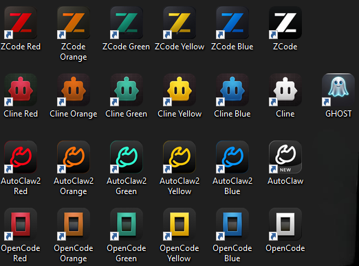

# Getting started — per-tool walkthroughs

Prerequisites are in the [main README](../README.md#prerequisites). Every reset
script is backup-first, verify-after, and leaves a timestamped `ID_Backups\<ts>`
folder with an audit log and a self-contained restore script.

## Windows

Scripts live in `src/windows/`. Run PowerShell **as Administrator** from the
repo root, or use `GHOST.bat` (interactive menu).

```powershell
.\src\windows\reset_cursor.ps1
.\src\windows\reset_devin.ps1
.\src\windows\reset_zcode.ps1 -Target Primary
.\src\windows\change_device_id.ps1
```

### 1. Reset Cursor ID (`reset_cursor.ps1`)

- Creates fresh identification numbers via `identity_utils.ps1`
- Updates `machineid`, `storage.json` (4 telemetry keys), `state.vscdb` (`storage.serviceMachineId`), deletes auth secrets (`cursorAuth/*`, `secret://cursorAuth/openAIKey`), rotates `device_id_salt` + `os_crypt.encrypted_key`, deletes Cookies / Network state / sentry / DIPS / Trust Tokens / Crashpad / logs / workspace DB entries (never the workspace files)
- Self-elevates to Administrator, aggressive process tree-kill, watchdog re-verify, old `ID_Backups` purge
- Every write is verified by re-reading; audit log + restore script are generated

**Before running:** Close Cursor. Run PowerShell as Administrator.

### 2. Reset Windsurf / Devin Desktop ID (`reset_devin.ps1`)

- Windsurf rebranded to **Devin Desktop** (June 2026, over-the-air) — the script auto-detects every existing data root under `%APPDATA%` (`Devin`, `Windsurf`) and resets **all** of them in one pass
- Resets Windsurf/Devin and Codeium configuration via `identity_utils.ps1`
- Updates `machineid`, `storage.json` (4 telemetry keys), `state.vscdb`, deletes auth secrets (`codeium.windsurf-windsurf_auth`, `windsurf_auth-*` + devin-named candidates), `argv.json` in `.windsurf` **and** `.devin` (`crash-reporter-id`, JSONC comments preserved), `.codeium\config.json` (`device_id`), `.windsurf\installation_id` + `cli\installation_id`, deletes `credentials.toml` (auth token), blanks `config.json` `devin.org_id`, scrubs username from Preferences/Local State, deletes Cookies / Network state / DIPS / extended cache dirs
- Timestamped backups + audit log under each root's `%APPDATA%\<root>\ID_Backups\<ts>`

**Before running:** Close Windsurf / Devin Desktop. Run PowerShell as Administrator.

### 3. Reset Trae ID (`reset_trae.ps1`)

- Resets Trae configuration via the Python core (thin manifest over
  `ghost_cli.py` — Python required for every step)
- Updates `machineid`, `storage.json` (4 telemetry keys + removes `iCubeAuthInfo://*` + `has_device_id_updated_to_aha=false`), `state.vscdb`, `ModularData\ckg_server\local_env.json` (`device_id` + `host_map`), deletes `aha` (encrypted TinyStorage), scrubs only identity rows in `ModularData\ai-agent` (**chat preserved**), Cookies / Network state / DIPS / SharedStorage / `Partitions\trae-webview` / workspace DB entries
- Timestamped backups + audit log under `%APPDATA%\Trae\ID_Backups\<ts>`

**Before running:** Close Trae. Run PowerShell as Administrator.

### 4. Reset Qoder ID (`reset_qoder.ps1`)

- 31 steps: `storage.json` (4 telemetry keys, main + `CORS_Profile`), `machineid`, `argv.json` (`crash-reporter-id`), `state.vscdb` + expanded auth-secrets delete (`aicoding.auth.*` incl. `loginBroadcast`, `secret.local.machine.variables`, `secret://blackbox.*`), `device_id_salt`, `os_crypt` rotation, browser data, `Crashpad`/`SharedClientCache`/`logs`, `.qoder` cache subdirs (reparse-point-safe), workspace UPSERT-only, plus system steps (HKCU deviceid, HKLM SQM MachineId, MAC, hostname — opt-out via `-SkipMac`/`-SkipHostname`), plus device-flow steps (`.qoder\installation_id` + `.auth\machine_id` rotation, credential/dns/endpoint cache delete, IndexedDB/Partitions/Storage webview purge, `.qoder\tmp\telemetry` + `logs` cleanup, read-only device-flow final probe)
- Timestamped backups + audit log under `%APPDATA%\Qoder\ID_Backups\<ts>`

**Before running:** Close Qoder. Run PowerShell as Administrator.

### 5. Reset ZCode ID (`reset_zcode.ps1`)

- 27 steps + `[6b/27]`: everything Qoder-side above (for the Qoder stores ZCode shares) plus `.updaterId`, `telemetry-state.json` (`deviceMid`), credentials OAuth clear, **config.json provider `apiKey` strip (fixes the Unlink → Checking loop)**, coding-plan-cache invalidation, RUM store, `setting.json` (`deviceSid`), session/embedded-browser Chromium data
- Thin manifest over the Python core since v1.5 — Python required for every step (fail-fast preflight); the per-profile Preferences salts are core-generated CSPRNG values (v1.4 shared one Get-Random salt across profiles)
- Chat stores (`tasks-index.sqlite`, checkpoints, IndexedDB webview data, Local Storage leveldb) are never touched
- Timestamped backups + audit log under `%APPDATA%\ZCode\ID_Backups\<ts>` (per-target: Secondary uses `%APPDATA%\ZCode-Second\ID_Backups\<ts>`, Third `%APPDATA%\ZCode-Third`, Fourth `%APPDATA%\ZCode-Fourth`, Fifth `%APPDATA%\ZCode-Fifth`, Sixth `%APPDATA%\ZCode-Sixth`)
- `-Target Primary` (default reset scope + Qoder steps; menu: ZCode [15] or IDE Resets [7] — both run the same reset), `-Target Secondary|Third|Fourth|Fifth|Sixth` (selective tree-kill, survivors keep running, Qoder untouched), `-Target Both` (Secondary then Primary, back-compat), `-Target All` (Third + Fourth + Fifth + Sixth + Secondary, then Primary incl. Qoder; each child generates its OWN fresh ID set — IDs are never duplicated across instances)

**Before running:** close only the TARGET instance (the script kills it; survivors keep running in Single mode). Run PowerShell as Administrator. After the reset, ZCode prompts for a fresh login. `change_device_id.ps1` is machine-wide and affects ALL instances + Qoder.

### 5b. ZCode clones (multi-instance setup: Primary + Second + Third + Fourth + Fifth + Sixth)

Run up to six fully independent ZCode windows side by side (separate Electron locks, separate SQLite stores, separate accounts):

```powershell
# Option A — menu: GHOST.bat → ZCode [1] Second / [2] Third / [3] Fourth / [4] Fifth / [5] Sixth / [6] all clones
# Option B — double-click: src\windows\Launch-ZCode-Blue.bat / -Yellow.bat / -Green.bat / -Red.bat / -Orange.bat
powershell -File src\windows\launch_zcode_second_instance.ps1 -Instance Third   # example
```

First launch of each clone copies history (`~\.zcode` → `~\ZCodeSecondHome\.zcode` / `ZCodeThirdHome` / `ZCodeFourthHome` / `ZCodeFifthHome` / `ZCodeSixthHome`, journals excluded), then scrubs the clone to fresh independent IDs (deviceMid, deviceSid, OAuth tokens, provider apiKeys) and reconciles Telegram bots via sha8 credential comparison across both `bot-config.json` and `bot-config.v3.json` (duplicates of Primary disabled, unique clone bots preserved with a v2 marker — a deliberate unique bot is never reverted; see [docs/ZCODE_TELEGRAM_BOTS.md](ZCODE_TELEGRAM_BOTS.md)). Later launches reuse the independent profile. Isolation is driven by five process-scoped env vars (`ZCODE_DATA_BASE_DIR`, `ZCODE_DESKTOP_USER_DATA_DIR`, `ZCODE_DESKTOP_SESSION_DATA_DIR`, `ZCODE_DESKTOP_HOME_DIR`, `HOME`) — the app overwrites `--user-data-dir`, so env vars are the only working lever. All instances share one install: a single update covers all, but re-run the icon patch (ZCode [28]) after updates. Clone branding: Second = blue, Third = yellow, Fourth = green, Fifth = red, Sixth = orange (separate taskbar buttons + window titles "ZCode Blue"/"ZCode Yellow"/"ZCode Green"/"ZCode Red"/"ZCode Orange"). One Telegram token = one polling instance (two pollers on one token cause HTTP 409 conflicts and random cross-account billing); `tools\set_zcode_bot.ps1 -VerifyOnly` audits all 6 homes (sha8 only, never values).

### 5c. ZCode clone utilities (`tools/`)

| Menu | Script | What it does |
|---|---|---|
| ZCode [28] | `tools\patch_zcode_icon_override.ps1` | One-time `app.asar` patch (engine v8) enabling the `ZCODE_ICON_DIR` / `ZCODE_AUMID_SUFFIX` / `ZCODE_ACCENT_HEX` / `ZCODE_INSTANCE_NAME` overrides — per-clone icon, separate taskbar button + pins, accent color, "ZCode <Color>" window title — plus **bidi auto-direction** in the chat: every paragraph/line auto-detects Arabic RTL vs English LTR, code blocks stay LTR, and `ZCODE_BIDI_OFF=1` disables it per launch. Auto-detects the install dir; re-run after **every ZCode app update**. `-Restore` rolls back, `-Force` re-patches, `-InstallDir` overrides detection; the marker file auto-upgrades patches made by older engines. |
| ZCode [8] | `tools\install_zcode_second_shortcuts.ps1` | Desktop + Start-menu shortcuts for all five clones (`ZCode Blue/Yellow/Green/Red/Orange.lnk` — the shortcut name equals the window title), each stamped with its own AppUserModel ID so taskbar pins never collide with the Primary. `-Instance Second\|Third\|Fourth\|Fifth\|Sixth` scopes, `-Remove` uninstalls, `-RepairPrimaryAumid` strips a stray clone AUMID from the Primary's `ZCode.lnk`. |
| ZCode [22] / [23] | `tools\refresh_zcode_second_chats.ps1` | Shows chats created in another instance inside a running sidebar, no app restart: finds shared-store chats missing from the target's tasks-index, recycles its app-server(s) (auto-respawn reseeds the index), then verifies. `-Target Primary\|Second\|Third\|Fourth\|Fifth\|Sixth\|All`; a hot-activity guard waits out in-flight turns (up to ~90 s, `-Force` bypasses). ZCode [22] = Second only, [23] = all instances. |
| ZCode [24] | same script, `-Watch -Target All` | Detached watcher: tails the CLI JSONL logs for terminal failures (captcha stall / quota / rate-limit — same signatures as `watch_zcode_captcha.ps1`) and refreshes every RUNNING instance on a 300 s cooldown. |
| ZCode [26] | `tools\watch_zcode_taskbar.ps1` | Resident taskbar-identity watcher: re-stamps `System.AppUserModel.ID` on every ZCode main window every 5 s (heals merges + fresh/splash-swapped windows), self-heals a hijacked Primary `ZCode.lnk` every ~5 m. `-RunOnce`, `-CheckPrimaryHijack`, `-InstallAutostart`/`-RemoveAutostart`. |
| ZCode [27] | `tools\diagnose_zcode_freeze.ps1` | Read-only freeze diagnostic: scans each instance's logs for renderer/child-process deaths + freeze events, reads crash-dump annotations, prints live RAM/commit pressure. `-Days N` widens the window. |
| ZCode [18] | `tools\sync_zcode_assets.ps1` | Primary→clone asset sync: MCP server definitions (per-clone toggles stay local), `.agents` skills junction, plugin-cache mirror; backup + verify-after + JSONL audit. `-Target Second\|Third\|Fourth\|Fifth\|Sixth\|All`, `-DryRun`; runs automatically before every clone launch. |
| ZCode [19] | same script, `-McpOnly -Target All` | One-shot MCP-definitions-only sync, safe against RUNNING instances (2026-10-27: the app holds no handle on `config.json`, never rewrites it on exit, and re-reads `mcp.servers` at every app-server spawn) — a synced definition lands on each clone's next chat with no restart. |
| ZCode [20] / [21] | `tools\watch_zcode_mcp_sync.ps1` | Resident MCP sync watcher: stat-guards the Primary's `~\.zcode\cli\config.json` and re-invokes the `-McpOnly` sync on every change (first pass converges drift, deep re-verify every ~5 min). [21] = one-shot with `-ApplyLive`, which additionally recycles running clones' app-servers idle-guarded (never mid-turn) so the currently open session gets the new MCP immediately. `-InstallAutostart` writes a hidden Startup shortcut. Log: `%LOCALAPPDATA%\watch-zcode-mcp-sync\mcp-sync.log`. |
| — (CLI only) | `tools\diagnose_zcode_throttle.ps1` | Read-only throttle diagnostic for "Reconnecting... x/10" / "The system is busy..." turn failures: lists Start-Plan admission-busy retries + failed turns with their cause chain (`providerCode 3009` model concurrency), an hourly histogram and a per-session rollup. Verified root cause (2026-10-27): server-side admission control, NOT a device/IP ban. No menu entry. |
| ZCode [7] / [29] | `src\windows\launch_zcode_cli_light.ps1` | Light headless worker (no desktop window, ~¼ of a full instance's RAM): `-Instance`, `-Prompt` one-shot, `-Server` stdio; ZCode [29] runs the one-time `-Login` plan setup for that clone home. |
| ZCode [25] | `tools\watch_zcode_captcha.ps1` | Detached captcha watchdog: tails the Primary for captcha stalls + quota failures, escalates via Telegram (`.envlocal` creds). PRIMARY instance only. |
| ZCode [31] | `tools\patch_zcode_exe_identity.ps1` | Builds per-color exe copies (`ZCode-Blue.exe` … `ZCode-Orange.exe`, ~235 MB each, support files shared) in the install dir so Task Manager shows one named colored group per clone; the clone launcher's step 2f fast-checks a sidecar marker and rebuilds on drift (app update / icon change). `-Target All`, `-DryRun`; ~1.2 GB disk for the five copies. |
| ZCode [32] | `tools\status_zcode_instances.ps1` | One read-only table for all six instances: running state, profile home, device-id freshness, commit pressure. |
| ZCode [33] | `src\windows\reset_zcode.ps1 -Target All -DryRun` | Dry-run reset planner: prints what a full reset would touch, writes nothing, never elevates. |

### 6. Reset QoderWork ID (`reset_qoderwork.ps1`)

- 26 steps: `machine-id`, `installation_id`, `.status.json`, Chromium profile (`Preferences` salt, Cookies, Local/Session Storage, caches, SharedStorage, `Local State`), `agents.db` OAuth + `app_settings` scrub (**chats/messages/projects preserved**), `auth.dat`/`auth-v2.dat`, HKLM MachineGuid, HKCU deviceid, HKLM SQM MachineId, MAC + hostname, old-backup purge, watchdog re-verify
- Thin manifest over the Python core — Python required for every file-level step (the registry/MAC/hostname system steps do not need it); `-DryRun` also runs without Python
- Supports `-SkipMac`, `-SkipHostname`, and `-DryRun` (prints actions without writing)

**Before running:** Close QoderWork. Run PowerShell as Administrator.

### 7. Reset MiniMax Agent / OpenCode (`reset_minimax_opencode.ps1`)

Combined reset for two Electron apps plus their CLI homes, with every path verified against a live install:

- **MiniMax Agent**: `%APPDATA%\MiniMax Agent` (Chromium profile) + `%USERPROFILE%\.minimax` (CLI home)
- **OpenCode**: `%APPDATA%\ai.opencode.desktop` (Chromium profile) + `%USERPROFILE%\.local\share\opencode` (CLI home)

Flags: `-KeepLogin` (preserves OpenCode `auth.json` for paid/topped-up Zen logins; default wipes to `{}` + prints the re-login command), `-SkipVersionCheck` (skips the client-version preflight — the server rejects outdated `User-Agent`s).

The 22 steps fall into six groups:

1. **Process kill** — aggressive tree-kill of MiniMax/OpenCode/mavis (wildcard-verified twice; hard-abort if unkillable). `node`/`python` and other IDE extensions are never matched.
2. **Auth wipes → `{}`** (forces re-login) — OpenCode `auth.json` and MiniMax `local-runtime.auth.json`. **Deleted instead** (v1.3, backup-first): MiniMax `mcode-public\auth.json` and `auth-state.json` (+ legacy root `.minimax\auth\auth-state.json` if present) — the app's `@mavis/oauth-core` schema-validates `auth-state.json`, so a `{}` file throws `Invalid OAuth state.` on every launch and the login page never shows; a **missing** file is the fresh-install state that lands on sign-in. Audit entries record node names/counts only — token values are never logged.
3. **ID rotation** — `.updaterId` (both apps), OpenCode `gh\device-id`, MiniMax `remote-control\state.json` `desktop_device_id` (regenerated preserving the value's original format), MiniMax `.minimax\v2\session-handoff\device-id` (v1.3 — a device GUID that survived all earlier resets), updater-tmp sweep, `windowIds[]` rotation + per-window UUID file deletion, `Local State → uninstall_metrics` removal.
4. **Chromium state per profile** — Cookies/DIPS/SharedStorage (incl. `-wal`/`-journal`/`-shm` suffix sweep)/Trust Tokens/Network Persistent State/TransportSecurity; Local Storage + IndexedDB (MiniMax main profile); Session Storage/WebStorage/Shared Dictionary; cache trees deleted per-file; Crashpad; logs; `Local State` `os_crypt.encrypted_key`; `Preferences` `device_id_salt` (rotated only if present). The `mavis-browser` partition is cleared on **Local Storage only**.
5. **MiniMax misc** — `shared_proto_db`, `observability-outbox.jsonl`, `embedded-browser-tabs.json`, `hot-update\`, `logs\`, `daemon.lock`, `lockfile` + `opencode\locks`, `tmp\`, `run\`, `auth.lock`, and the `user`/`sharedUser` nodes of `minimax-agent-config.json` (the `config` node is kept).
6. **Finale** — watchdog re-probe (re-deletes anything a slow shutdown recreated), old `ID_Backups` purge, JSON audit log, self-contained restore script, done marker, exit 1 on any failure.

Safety features — never wiped:

- `%USERPROFILE%\.local\share\opencode\opencode.db` (+ `repos/`, `snapshot/`, `storage/`, `tool-output/`) is app-shared storage, preserved in place and never copied to backups. Storage isolation is the app-side fix; keep the app updated.
- MiniMax user content: `sessions\` (chat history), `sqlite.db` (+shm/wal), `memory\`, `plans\`, `workspace\`, `bin\`, `mcp\`, `credentials\mavis\telegram.json`, `state\`, `v2\` (except the rotated `v2\session-handoff\device-id`), and every other non-targeted `.minimax` item.
- OpenCode user content: `drafts.sqlite`, `window-state*.json`, `Local Storage`, `skills\`, `pnpm\`, `.config\opencode\`, `mcp-auth.json` (third-party).
- `%USERPROFILE%\.mavis` is a junction to `.minimax` — audited only, never touched (reparse-point guard on all deletions).
- Backup-first for every change; if a run changes nothing, the empty backup dir is removed and no restore script is written.

**Before running:** Close MiniMax Agent and OpenCode first, and run from a terminal *outside* OpenCode (the script also force-kills them). Run PowerShell as Administrator. Python is required since v1.4 — the script performs no SQLite writes, but every JSON/file store mutation routes through the Python core (fail-fast preflight).

### 8. Change Windows Device ID (`change_device_id.ps1`)

| Mode | Description |
|------|-------------|
| `Fingerprint` (default) | JSON fingerprint from system signals; does not modify IDs |
| `LegacyReset` | Changes Windows device IDs and computer name (Admin); also writes a fictional CPU name (`cpu.name` spoof, 2026-10-18) so the fingerprint self-test's heaviest changeable signal actually moves |
| `RepairProfiles` | Repairs ProfileList `.bak` keys (Admin) |

```powershell
.\src\windows\change_device_id.ps1
.\src\windows\change_device_id.ps1 -Mode LegacyReset
.\src\windows\change_device_id.ps1 -Mode RepairProfiles
```

> Note: machine-wide — affects **all six** ZCode instances + Qoder at once.

### 8b. Spoof WMI hardware serials (`spoof_wmi_serials.ps1`)

Opt-in, system-level, and never part of any IDE reset flow (Maintenance [3],
behind a confirm prompt). Generates a `.mof` with `[DYNPROPS]` redeclarations
and compiles it via `mofcomp` to serve fresh serials for `Win32_BIOS`,
`Win32_BaseBoard`, `Win32_ComputerSystemProduct`, `Win32_SystemEnclosure`,
`Win32_DiskDrive`, and `Win32_PhysicalMemory`, plus the SQMClient `UserId` and
the Bluetooth `LocalAddress` (`-SkipBluetooth` opts out). Backs the WMI
repository up first (`winmgmt /backup` aborts on failure), re-queries every
class after the write (verify-after is the arbiter), and generates a
`winmgmt /restore` script for rollback. `-DryRun` plans without writing.
WMI layer only — it does not move the fingerprint self-test score; scope and
honest limits: [WMI_SERIAL_SPOOFING.md](WMI_SERIAL_SPOOFING.md).

```powershell
.\src\windows\spoof_wmi_serials.ps1 -DryRun
.\src\windows\spoof_wmi_serials.ps1
```

### 9. Other clone suites (Cline / OpenCode / AutoClaw2)

The same "Primary + 5 clones" pattern exists for three more apps, each with
its own spec doc (menu ranges: AutoClaw2 [1]-[25], Cline [1]-[23], OpenCode
[1]-[27]):

<p align="center">
  
  <br/>
  <em>One color vocabulary across all four suites: stock Primary icon + Blue/Yellow/Green/Red/Orange clones, plus the GHOST launcher icon.</em>
</p>

- **Cline** (Tauri/WebView2) — env levers only (`CLINE_DIR`,
  `WEBVIEW2_USER_DATA_FOLDER`, fixed per-clone hub/sidecar ports); the
  launcher neutralizes the app's single-instance hidden window and enforces
  per-clone locks itself. [CLINE_CLONES_SPEC.md](CLINE_CLONES_SPEC.md)
- **OpenCode desktop** (Electron) — needs the one-time clone-home asar patch
  (OpenCode [10]; the row waits for you to close OpenCode first; re-apply
  after app updates — the launcher aborts loudly when it is missing);
  per-clone `XDG_*` CLI-state homes; native per-userData
  single-instance lock; ephemeral service ports.
  [OPENCODE_CLONES_SPEC.md](OPENCODE_CLONES_SPEC.md)
- **AutoClaw2** (Electron, v2.1.1 "zwork") — pure env levers
  (`ZWORK_USER_DATA` + `AUTOCLAW_PROFILE_ROOT`), no patching; wired into
  `GHOST.bat` main [4] (rows [1]-[25]). [AUTOCLAW2_CLONES_SPEC.md](AUTOCLAW2_CLONES_SPEC.md)

Command-level detail for all three suites (including the per-suite MCP
syncs, taskbar watchers, pressure reports and dry-run plan rows):
[cli.md](cli.md).

### 10. Maintenance rows (System & GHOST Maintenance)

| Menu | Script | What it does |
|---|---|---|
| Maintenance [1] | `tools\install_ghost_shortcut.ps1` | Desktop + repo-root GHOST.lnk shortcuts carrying the launcher icon; `-Remove`, `-DesktopOnly`, `-RepoOnly`. |
| Maintenance [2] | `tools\update_ghost.ps1` | Repo self-updater (same as main-menu `[U]`): guarded `git pull --ff-only`; ZIP-copy conversion / direct-download handling. |
| Maintenance [3] | `src\windows\spoof_wmi_serials.ps1` | WMI serial spoof — see 8b above. |
| Maintenance [4] | `tools\sync_mcp_registry.ps1` | MCP central registry importer: `tools/mcp/master-mcp.json` (+ gitignored `.local` overlay) into every target app's own config shape; `-DryRun` previews, `-Target` narrows. Plan: [MCP_CENTRAL_REGISTRY_PLAN.md](MCP_CENTRAL_REGISTRY_PLAN.md). |
| Maintenance [5] | `tools\build_ghost_exe.ps1` | Builds the GHOST.exe desktop launcher (in-box csc.exe; runtime menu data from `src/desktop/menu.json`). |

The desktop launcher (`GHOST.exe`, repo root) mirrors the `GHOST.bat` menu
one-to-one — double-click it and UAC elevation comes from its baked-in
manifest; parity with the `.bat` menu is test-enforced
(`tests/ghost_hub_menu.Tests.ps1`).

## Linux

Scripts live in `src/linux/`. Requirements: bash 4+, python3 (recommended), `uuidgen` or readable `/proc/sys/kernel/random/uuid`, `openssl` or `xxd`, `sudo` only for `/etc/machine-id`.

```bash
cd /path/to/this/repo
chmod +x src/linux/*.sh
./ghost.sh
```

Or run scripts directly:

```bash
# Cursor (close Cursor first)
./src/linux/reset_cursor.sh
sudo ./src/linux/reset_cursor.sh   # also resets /etc/machine-id

# Windsurf/Devin (close Windsurf/Devin first)
./src/linux/reset_devin.sh
sudo ./src/linux/reset_devin.sh

# Trae (close Trae first)
./src/linux/reset_trae.sh

# Fingerprint only (no root)
./src/linux/change_device_id.sh Fingerprint

# Reset Linux system machine-id (root)
sudo ./src/linux/change_device_id.sh ResetMachineId
```

### Linux paths

| App | Config location |
|-----|-----------------|
| Cursor | `~/.config/Cursor/` |
| Windsurf/Devin | `~/.config/Windsurf/`, `~/.windsurf/`, `~/.codeium/` |
| Trae | `~/.config/Trae/` |
| Fingerprint state | `~/.local/state/LicenseIdentity/fingerprint_state.json` |

`XDG_CONFIG_HOME` and `XDG_STATE_HOME` are respected when set. The full
per-OS path maps (with provenance flags) live in `src/python/ghost/platform.py`
— resolve them with `python3 src/python/ghost_cli.py paths <slug>`.

### Linux scripts

- `reset_cursor.sh` — Resets Cursor IDs (`machineId`, `storage.json`,
  `state.vscdb`) through the shared Python core; timestamped
  `ID_Backups/<ts>` + JSONL audit + a self-contained `restore.sh`
- `reset_devin.sh` — Resets Devin (formerly Windsurf) and Codeium IDs
  (Codeium-era waitlist URL scrubbed); same audit/restore standard
- `reset_trae.sh` — Resets Trae IDs (promoted from the local-only archive
  v0.1 and modernized); deeper Windows-side Trae stores not covered on
  Linux yet
- `reset_qoder.sh` / `reset_qoderwork.sh` — Derived-path resets
  (storage.json + state.vscdb + machineid file); deeper Windows stores not
  covered on Linux yet
- `reset_zcode.sh` — Default-profile reset (Electron stores); the shared
  CLI session store is deliberately untouched (matches the Windows reset)
- `reset_minimax_opencode.sh` — Derived-path reset; the OpenCode CLI XDG
  stores are deliberately untouched (they carry the CLI login)
- `reset_zcode.sh --instance Second|Third|Fourth|Fifth|Sixth` — ZCode clone
  reset (identity + desktop userData; ghost.sh option 11)
- `launch_zcode_clone.sh` — per-clone desktop launcher: seeds the clone home
  from the Primary (first run), scrubs identity via the Python core —
  FAILS CLOSED without it, so a clone never runs on the Primary's identity
  (ghost.sh option 10)
- `launch_zcode_cli_light.sh` — light headless worker on the clone home
  (no Electron; ghost.sh option 12)
- `sync_zcode_assets.sh --instance Second|...|All` — Primary→clone MCP
  definitions sync through the core `json-merge-defs` verb (Primary defs
  win, clone-local toggles survive; `--dry-run` supported; ghost.sh
  option 13 — the MCP-only area, the Windows-verified safe one)
- `change_device_id.sh` — `Fingerprint` or `ResetMachineId`
- `id_reset_common.sh` — Shared helpers (core bridge, backups, audit,
  restore emission, verify-after) sourced by the scripts above
- `ghost.sh` — Interactive menu (repo root; options 1-13: resetters,
  fingerprint, machine-id, then the ZCode clone layer at 10-13)

> **Note:** `change_device_id.ps1` modes `LegacyReset` and `RepairProfiles` are **Windows-only** (registry and profile list). On Linux use `ResetMachineId` for system ID changes.
