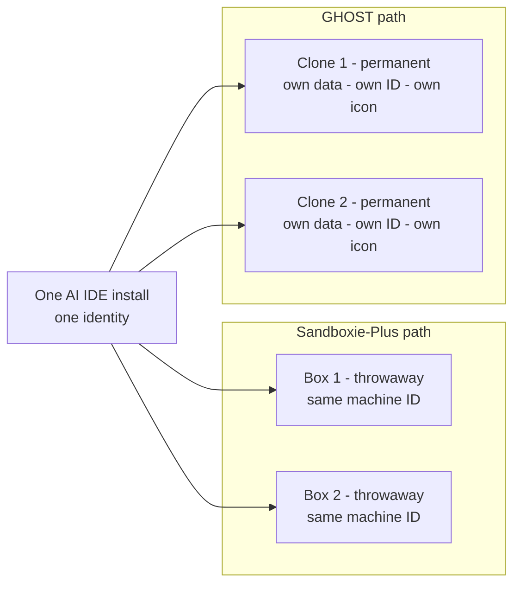

# Why not just use Sandboxie?

A fair question — [Sandboxie-Plus](https://github.com/sandboxie-plus/Sandboxie)
is free, mature, and genuinely good at what it does. It just solves a different
problem than GHOST.

**Sandboxie isolates an app's file writes; it does not change the app's
identity. GHOST gives every instance its own fresh identity, data, and Windows
presence — permanently.**

## The difference in one picture

A sandboxed app still reports the same telemetry IDs from inside its box — it
is the same person in a locked room. A GHOST clone is a different person: own
data directory, own ID set, own taskbar icon and title.

## Side by side

| Capability | Sandboxie-Plus | GHOST |
|---|---|---|
| Isolates an app's file writes | ✅ its core job | ❌ not GHOST's goal |
| Fresh per-instance identity (`machineId`, `devDeviceId`, `sqmId`, `macMachineId`) | ❌ same IDs inside the box | ✅ fresh set per clone and per reset |
| Persistent independent profiles (own account, settings, chats) | ❌ boxes are throwaway | ✅ permanent clone homes you return to daily |
| Windows taskbar identity (own icon, title, pin grouping) | ❌ | ✅ ZCode, OpenCode, and AutoClaw2 clone suites |
| Works around app single-instance locks | n/a | ✅ env-var levers and launcher handling |
| Identity resets across the covered AI IDEs + system-level tools | ❌ | ✅ Cursor, Windsurf/Devin, Trae, Qoder, ZCode, QoderWork, MiniMax/OpenCode, AutoClaw2 |
| Safely running untrusted software | ✅ | ❌ use Sandboxie for that |

## When to use which

- **Sandboxie-Plus**: running software you don't fully trust, testing an
  installer, quick throwaway trials. GHOST does not replace it there — it is
  the better tool for that job.
- **GHOST**: long-lived parallel work — multiple AI-IDE accounts and workspaces
  you return to daily, plus fresh-start identity resets when a trial or device
  binding runs out. The clone suites are documented per app:
  [getting-started](getting-started.md) (per-tool walkthroughs),
  [Cline](CLINE_CLONES_SPEC.md), [OpenCode](OPENCODE_CLONES_SPEC.md),
  [AutoClaw2](AUTOCLAW2_CLONES_SPEC.md).

## Notes

- "Fresh identity" means GHOST rewrites the app's **own** ID and telemetry
  stores on your machine — see [How it works](../README.md#how-it-works). It is
  not an anonymity product against hardware-level fingerprints; the
  machine-level tools (`change_device_id.ps1`, `spoof_wmi_serials.ps1`) are
  separate optional steps with their own documented limits.
- Both tools can coexist: nothing in GHOST conflicts with a Sandboxie
  installation on the same machine.

Related: [FAQ](faq.md) · [Getting started](getting-started.md)
